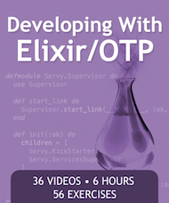
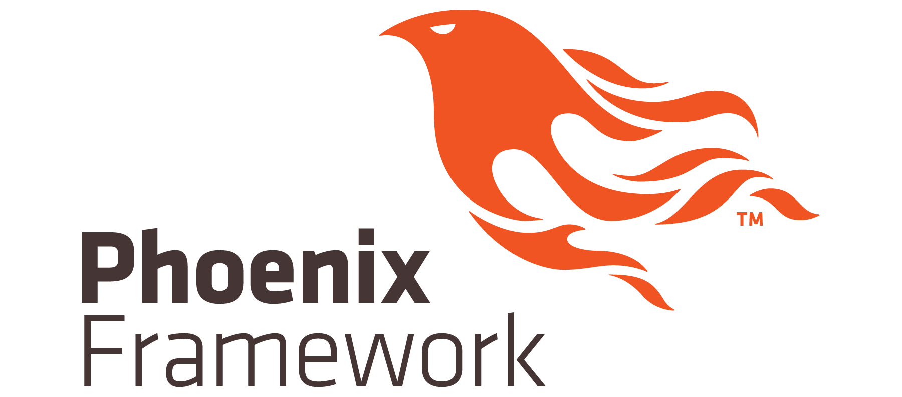
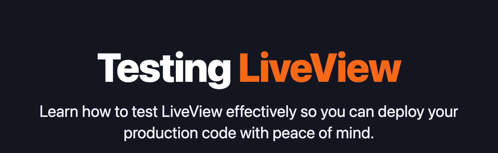

## Why learn Elixir?

### You have to build systems that are more reliable & scale
The last couple of decades we as an industry experiemented with different strategies
(ie. runtimes, languages, libraries and frameworks) to achieve this.

Elixir is built on Erlang & OTP and the actors model. This foundation provides the right
building blocks to build such systems.
`youtube: https://www.youtube.com/watch?v=cNICGEwmXLU&list=FLpUy0Gk8KmnaU9CPEJUmP0w&index=5`

### You have to manage systems level complexity
Various languages & ecosystems out there (ie. Node, Python, PHP, JAVA, etc.) rely on complex devops setups as they
have to externalise core functionality to "side cars" : caching, queues, cron jobs, etc. 

Your project is no longer just the "backend server" & a database. It's a bunch of other things as well like : [Redis](https://redis.io/) for caching, [RabbitMq](https://www.rabbitmq.com/) for queuing,
[Temporal](https://temporal.io/) for complex jobs / workflows, etc. The root cause of this "explosion" of "side cars" 
are limitations inherent in these runtime & languages.  

With Elixir there is considerable less need for this devops complexity. In most cases your project can stay just a backend server & a database.
`youtube: https://www.youtube.com/watch?v=EDfm2fVS4Bo&list=FLpUy0Gk8KmnaU9CPEJUmP0w&index=7`

## Learning Elixir basics

(https://pragmaticstudio.com/courses/elixir)

You learn to put Elixir and OTP into action as you build a concurrent, fault-tolerant application from scratch in this 6-hour video course from The Pragmatic Studio. By developing a real app with real code, you’ll gain practical experience putting all the pieces together to craft applications the Elixir/OTP way.

The first half of the course focuses on core Elixir facets, principles, and techniques. In the second half, we go beyond the basics and focus on what sets Elixir/OTP apart: concurrent processes, the actor model, OTP behaviors, and fault recovery.

As a new Elixir dev, you’ll get step-by-step guidance in an engaging format you won’t find anywhere else. If you have experience with Elixir, you’ll gain a deeper understanding of things you’ve been taking for granted and fill in any knowledge gaps.

## Learn Phoenix the go-to Elixir web framework 
(https://pragmaticstudio.com/courses/phoenix-liveview)

It's a carefully-crafted course that ticks all the boxes so you can quickly start building LiveView apps like a pro with:

- real-world mini-projects that solve a variety of common challenges
- practical techniques you can immediately apply to your own projects
- super-clear explanations so you get good mental models
- a look behind the scenes so nothing is left as "magic"
- step-by-step progression that fills in all the gaps
- meaningful exercises to lock in what you learn
- engaging, tightly-edited videos that value YOUR time!

## Testing the web app
Elixir comes with all the expected features for unit, functional & integration testing. The language & common testing libraries
makes this as painless as it gets.

An important testing use case is testing the web app. In other tech stacks this is not easy as you have to provision a testing
environment that spans all the layers in your system (ie. backend, api, frontend). If you use Phoenix as a web framework this
complex testing use case can be replaced by simply testing your LiveView. 

(https://www.testingliveview.com/)

### References
- [Elixir homepage](https://elixir-lang.org/learning.html) : Resources for learning Elixir
- [Phoenix](https://www.phoenixframework.org/) : The Phoenix Framework
- [The Phoenix Files](https://fly.io/phoenix-files/) : Inttersting articles from Fly.io (Heroku / Paas for Elixir / Phoenix apps)
